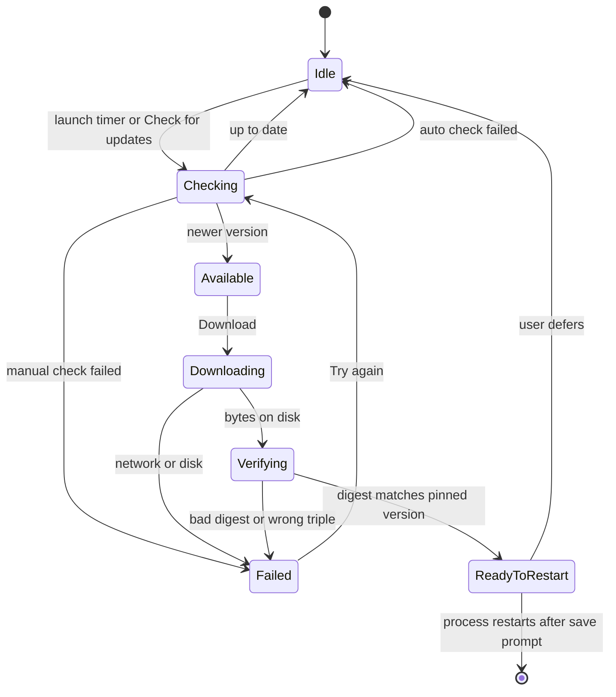

Build order and the first native slice are in [PRD.md](PRD.md). This file is the product. The PRD wins on sequence and on what the first Linux ARM build contains.

# Ohmypipeline

Native desktop tool for a visual table pipeline and the chart at the end of it. One Rust binary, `ompp`. GUI with no arguments. Headless with the command already chosen:

```text
ompp --pipeline xx.pp --input xxx.csv
```

UI is GPUI Kit only. No web view. Dock, DataTable, Chart, Plot, Command, Settings, Notification, Progress, AlertDialog. Behavior we do not get from those is ours: the graph canvas, the free chart chrome, the executor.

This document is the design. It is not a backlog of options.

## Decisions

| | Choice | Why |
| --- | --- | --- |
| Engine | pandas, in a worker | A feature calls pandas, or a code block the user wrote. Polars would not be that call. The Rust UI never holds the frame. |
| Shared core | Crate `pipeline` has no GPUI | GUI and CLI call the same graph, or they will drift. |
| File | UTF-8 JSON, `*.pp`, `format: ohmypipeline`, `version: 1` | Diffable. Stable key order. Write via temp file, fsync, rename. |
| Default work | Preview of at most 10,000 source rows | Readers stop at 10,000 rows, then the pipeline runs on that. Full stays disabled until this preview succeeds. |
| Table | A window, never the frame | DataTable virtualizes the preview. It does not hold the file. |
| Chart marks | GPUI Chart, else Plot | Line, bar, area, pie, radar, candlestick, sankey are stock. Scatter and histogram are Plot. |
| Chart chrome | Real text elements over the plot | Title and legend drag because they are views. Stock charts have legends; they do not free-place them. Hide the stock legend. |
| Aggregates | Never faked | Group, sort, join, pivot either run for real or say they have not. |
| Update | Consent, then replace a portable install | GPUI does not ship an updater. Package-managed installs are not self-replaced. |

Rejected: Polars as the engine; a node named rows or columns; eager work on the UI thread; a second chart file; pixel positions for title and legend; `read_pickle` (a file can run code that is not on the canvas).

## A node is a feature

A feature is the unit on the canvas. Some features are pandas functions. Some are not: a literal, a chart, a code block. The palette is features, not a second name for the pandas module list.

Every feature has two kinds of input.

| Kind | Where it is set | Examples |
| --- | --- | --- |
| Parameter | Inspector. A literal. | `n=500`, `how="inner"`, a code editor |
| Input | A wire from another feature. | a DataFrame, a Series, a list, a dict, an Index, an ndarray, a scalar |

A parameter can be switched to a wire. The port appears, the literal is kept as the default until something is connected. A code block is a parameter with an editor. It can also be a wire of type `code`, and the wire wins when connected.

There is no feature named rows and no feature named columns. Taking rows is `loc`, `iloc`, `query`, `drop`, `head`. Taking a column is `column` (`DataFrame.__getitem__`) and it returns a Series. A Series is a real value. It is not wrapped back into a one-column DataFrame unless the feature's declared output is a DataFrame (`to_frame` does that on purpose).

Port types: `dataframe`, `series`, `index`, `scalar`, `list`, `dict`, `ndarray`, `code`. A port lists the types it accepts. Snap and insert-on-wire work only when the output type is accepted. A mismatch is refused, the cursor is prohibited, and the status line names the two types.

One output still fans out. `merge`, `concat`, `join`, and `compare` grow inputs with Add input. A Group still only packs features. It is not a feature.

### Change headers

`change_headers` is its own feature. It is `DataFrame.rename` for a mapping and `set_axis` for a full new list. Parameter: the mapping, edited as old name beside new name. That parameter can be wired as a `dict` or a `list`. Empty on the right keeps the old name. Duplicate new names are an error on the feature.

### Code

`python` is a feature. The code parameter is:

```python
def run(df, amount):
    return df[df["amount"] > amount]
```

Argument names are the input ports. The user adds a port and sets its type. The return value is the output; the user sets that type too. `apply`, `map`, `pipe`, `transform`, and `agg` take the same kind of code block when the function is not one of the named reducers.

Running a pipeline runs its code blocks. The worker does not sandbox them. A `.pp` from someone else is code. The GUI shows the block before Run. The CLI has no extra prompt.

### Catalog

The pandas surface we will eventually cover is the public DataFrame, Series, general-function, and IO lists in pandas 3.1.1. What follows is the included set: the calls that show up in the official cheat sheet, in "10 minutes to pandas", and in the DataFrame sections people use to clean, join, reshape, and reduce. A name not listed here is absent. It is not implied by a nearby name.

Checked against the pandas 3.1.1 reference: [DataFrame](https://pandas.pydata.org/docs/reference/frame.html), [general functions](https://pandas.pydata.org/docs/reference/general_functions.html), [IO](https://pandas.pydata.org/docs/reference/io.html), [text](https://pandas.pydata.org/docs/user_guide/text.html), [groupby](https://pandas.pydata.org/docs/user_guide/groupby.html).

| Feature | pandas | Inputs besides parameters |
| --- | --- | --- |
| read_csv, read_table, read_fwf | `read_csv`, `read_table`, `read_fwf` | path parameter, or a wired path |
| read_excel | `read_excel` | path, sheet |
| read_sql | `read_sql` | SQLite path, table or a single SELECT |
| read_json, json_normalize | `read_json`, `json_normalize` | path, or a `list`/`dict` for normalize |
| read_parquet, read_html, read_xml | those readers | path |
| to_csv, to_excel, to_json, to_parquet, to_sql | the writers | one dataframe or series |
| change_headers | `rename` / `set_axis` | dataframe, optional dict or list |
| rename_axis, add_prefix, add_suffix | those methods | dataframe |
| set_index, reset_index, reindex, droplevel | those methods | dataframe; `reindex` may take an index |
| column | `__getitem__` | dataframe → series |
| to_frame | `Series.to_frame` | series → dataframe |
| loc, iloc, at, iat, xs, take | those indexers | dataframe or series |
| filter, drop, pop, get | those methods | dataframe or series |
| query | `DataFrame.query` | dataframe, expression parameter |
| isin, between | `isin`, `Series.between` | dataframe or series, plus a list or two scalars |
| where, mask | those methods | dataframe or series, condition series, optional other |
| head, tail, sample | those methods | dataframe or series |
| sort_values, sort_index, nlargest, nsmallest | those methods | dataframe or series |
| duplicated, drop_duplicates | those methods | dataframe or series |
| isna, notna, dropna, fillna, ffill, bfill, interpolate, replace | those methods | dataframe or series; `fillna` may take a series or a dict |
| assign, insert | `assign`, `insert` | dataframe, plus a series for the new column |
| astype, convert_dtypes, infer_objects | those methods | dataframe or series |
| dtypes, columns, index, shape, memory_usage, select_dtypes | inspection | dataframe → series, index, or scalar |
| info, describe | `info`, `describe` | dataframe → dataframe (`info` is a frame, not stdout) |
| merge, merge_asof, merge_ordered | those functions | two dataframes |
| concat | `concat` | N dataframes or series |
| join, combine_first, compare, update, align | those methods | two dataframes |
| pivot, pivot_table, melt, wide_to_long, crosstab | those functions | dataframe; `crosstab` takes series or list-like |
| stack, unstack, explode, transpose, squeeze | those methods | dataframe |
| groupby | `groupby` then `agg`, `transform`, `filter`, or `size` | dataframe, optional series keys |
| rolling, expanding, ewm, resample | those methods, then one reducer | dataframe or series |
| sum, mean, median, min, max, std, var, sem, skew, kurt, count, nunique, size, first, last, prod, quantile, mode | the reducers, also legal inside groupby | dataframe or series → series, or a scalar when the input is a series and `axis` is none |
| any, all, idxmax, idxmin | those methods | dataframe or series |
| abs, clip, round, rank, diff, pct_change, cumsum, cummax, cummin, cumprod | those methods | dataframe or series |
| corr, cov, corrwith, value_counts | those methods | dataframe or series |
| eval | `DataFrame.eval` | dataframe, expression parameter |
| arith | `add` `sub` `mul` `div` `floordiv` `mod` `pow` `eq` `ne` `lt` `gt` `le` `ge` `dot` | dataframe or series, other is a scalar, a series, or a dataframe |
| apply, map, pipe, transform, agg | those methods | dataframe or series, and a named reducer or a code block |
| str | `Series.str` methods below | series, or a dataframe plus a column parameter |
| dt | `Series.dt` accessors below | series, or a dataframe plus a column |
| to_datetime, to_timedelta, to_numeric | those functions | series, or a list, or a column of a dataframe |
| date_range | `date_range` | parameters, or wired start/end scalars → index |
| cut, qcut | `cut`, `qcut` | series → series |
| get_dummies, factorize, from_dummies | those functions | series or dataframe |
| shift, asfreq, tz_localize, tz_convert | those methods | dataframe or series |
| python | the code block above | ports the user adds |
| literal | none | no input; output is scalar, list, dict, or code |
| chart | none | one dataframe |

`str` methods included, because each is on the text user guide's working set: `lower`, `upper`, `title`, `strip`, `lstrip`, `rstrip`, `len`, `contains`, `replace`, `slice`, `split`, `rsplit`, `extract`, `startswith`, `endswith`, `cat`, `get`, `zfill`, `pad`, `count`, `find`, `match`, `isalnum`, `isalpha`, `isdigit`, `isnumeric`. The method is a parameter of the one `str` feature.

`dt` accessors included: `year`, `month`, `day`, `hour`, `minute`, `second`, `dayofweek`, `day_name`, `quarter`, `date`, `floor`, `ceil`, `round`, `strftime`. Same pattern as `str`.

Not included, on purpose:

- `read_pickle`, `to_pickle`, HDFStore. A pickle is code that does not appear as a block.
- `DataFrame.plot`. The chart feature draws.
- `iterrows`, `itertuples`. They do not produce a value the next feature can take. A code block can loop if someone insists.
- Flags, `attrs`, styling, `to_latex`, `to_html`, `to_xarray`, hashing, the interchange protocol.
- The long tail of MultiIndex edits (`swaplevel`, `reorder_levels`) and clock-face slices (`at_time`, `between_time`). `stack` and `unstack` stay, because reshape uses them.

XLSX is cached values, not formula recalculation. Index alignment is pandas' own.

Not a dashboard, not Longbridge Pro's trading catalog, not headless PNG. The CLI emits CSV from the chosen feature. Chart export waits on a GUI render path.

## The task

The object is one pipeline document.

The primary task is: connect features on the canvas, see the value that came out, and branch where a feature takes more than one input. The chart is a feature at the end, not another product.

Immediately available, in this order: Open, Save, Add after selection, Run, search the preview.

A person decides from the selected node's summary, the preview window, the row count, and whether that count is the 10,000-row preview or a full pass. If the screen does not say which, the screen is wrong.

## Shell

Document workspace. Dock persists the user's splits in app settings. The `.pp` does not store the dock. Minimum window 960×640. Narrower than that: palette becomes an icon rail, inspector becomes a sheet, graph and preview stay.

```text
 Ohmypipeline — revenue.pp ●          Preview   Full dataset
 File   Edit   Node   View   Help
┌────────────┬──────────────────────────────┬──────────────┐
│ Features   │  [read_csv] → [query] → [change_headers] │          │
│ IO         │         ↘                     ↘          │ old → new    │
│ Labels     │       [select]              [sort]      │ [..........] │
│ Select     │                                          │              │
│ Shape      │                                          │              │
│ Code       │                                          │              │
│ Chart      │                                          │              │
├────────────┴──────────────────────────────┴──────────────┤
│ Preview · 10,000 source rows max · not the file          │
│ amount    region    month                                │
│ 12.40     N         2024-01                              │
└──────────────────────────────────────────────────────────┘
```

Full dataset is disabled until the preview for the current graph succeeds. Editing the graph disables it again. The status line is part of the preview, not a second footer fighting it.

Regions, each with a min, a default, and a way to take surplus:

| Region | Min | Default | Surplus |
| --- | --- | --- | --- |
| Palette | icon rail | ~220 px, labels stable | no |
| Graph / chart | readable card | the rest | all leftover width |
| Inspector | ~260 px | ~300 px | no |
| Preview | ~6 rows | ~30% height | user split, persisted |

Compact density on the palette, toolbar, menus, and table. Medium on the inspector. The chart surface is the one place that stays spacious. No card inside a card. Hairlines separate regions. One region owns each hairline.

Color comes from `cx.theme()`. Series colors are the exception that is data: a small palette defined in the product theme, not hex at the call site. Status uses the status colors for status only. Dtypes and "example" are muted text, not a row of badges.

Light and dark both have to work. UI zoom goes through `rem`. Canvas zoom is a separate camera. Do not implement either by scaling text alone.

## Connecting

Ports are typed, and they are large. Drag an output onto an input that accepts that type, or onto the body of a feature that still has a free input of that type. Release near a matching port and it snaps. A type mismatch does not snap. Drop a new feature on an existing wire and it inserts itself only if its input accepts the upstream type and its output feeds the old target. Drag a port into empty canvas and the catalog opens, already filtered to features that can take that type.

A second branch is a second drag off the same output. `concat`, `merge`, and `join` show Add input on the card, always, not on hover. A cycle is refused at drop.

The port button "Add node after {label}" stays. It is the keyboard path for the same action. Ctrl/Cmd+K is the catalog. Grid snap is 16 px in canvas space at zoom 1. Pan with middle mouse or Space+drag. Zoom with Ctrl+wheel.

## Marks

Marks are not operations. The worker never sees them. `ompp` ignores them. They exist so a canvas can be demonstrated: a rectangle around a branch, a note on why it merges, a label on a wire's meaning.

| Mark | What it is |
| --- | --- |
| Label | One line of text |
| Note | A short card, text wraps, resizable |
| Button | A labeled control. Action is none, or focus a node. It does not run Python |
| Rectangle | Fill and optional hairline |
| Circle | Same |

Color is a swatch, `c1`–`c6` from the product theme, plus neutral. Stored as the swatch name, not a hex. Light and dark both resolve it. One swatch per mark.

Order on the canvas, back to front: rectangles and circles, wires, operation nodes, labels, notes, buttons. Commands: bring forward, send back, within that rule. Marks have no ports. They cannot be wired.

Select, move, resize, duplicate, and delete match the nodes. Arrow keys nudge. A mark is not a pipeline error and has no status dot.

## Node card

Fixed width, height from content. Icon, type, status dot, then one muted line: the param summary, or the error.

| Dot | Means |
| --- | --- |
| muted | not run |
| success | preview matches the current params |
| warning | stale, upstream changed, last preview kept |
| danger | error, or blocked because upstream errored |
| foreground, pulsing only while reduced-motion is off | running |

Selection is a fill on the card, not a bar on its leading edge. The selected wire uses the same emphasis. Delete and Duplicate are on the Node menu, the context menu, and the keyboard. They are not icons revealed by hover.

Double-click does not open a modal. It focuses the inspector. KNIME's modal config is the interaction we are not copying.

## Inspector

Live. Editing a field marks this node and everything downstream stale. It does not recompute the world. Leaving the field groups one undo transaction. A drag of a card is one transaction on pointer up.

Errors sit under the field that caused them. The status line repeats the first error and focuses that node when activated. No problems panel.

Destructive graph edits undo. They do not use an alert dialog. Closing a dirty file does: Save, Don't save, Cancel. Name the file in the copy.

## Preview

The table shows the rows the worker returned for the current mode. It does not hold the file. `render_td` only runs for visible rows. Numbers are right-aligned, mono. Null is an em dash, never the letters n-u-l-l. The source index is a pinned column, so row 1 of the window is not mistaken for row 1 of the file.

DataTable sort and search apply to the window only. A button, "Add as node", turns a non-empty search into a Filter node whose expression the user can see, then selects that node. Sort becomes a Sort node the same way. The table must not become a second, silent pipeline.

What the window is allowed to claim:

| Mode | What runs | Status |
| --- | --- | --- |
| Preview, the default | Each reader takes at most 10,000 rows (`nrows`, SQL `LIMIT`, or the Excel row cap). The rest of the pipeline runs on that input, including sort and groupby. | `preview · at most 10,000 source rows · {n} rows` |
| Full dataset | Enabled only after that preview succeeds for the current graph. The same pipeline runs with no reader cap. The table still shows a window, not the frame. | `full · showing first {window} · {n} rows` |

A failed preview leaves Full disabled. A graph edit after a successful preview disables it until preview succeeds again. Opening a source does not insert a head node and does not scan the file for a count. The UI never blocks on a count.

CSV uses `read_csv` with the sniffed separator. XLSX uses `read_excel`; the help text says cached values. SQLite uses `read_sql` of `SELECT * FROM t`. Preview passes `nrows` or wraps the read in a limit. No free-form SQL box.

Switching the selected node cancels the in-flight preview. A generation counter drops late results.

## Chart

A chart node has one table input and no table output. Encodings live in the inspector: type, x, y, optional series. The chart does not group. If y is not numeric, the field is in error. If the frame to plot has more than 20,000 points, it refuses and names the count, and tells you to aggregate or sample. It does not draw the refusal as an empty axis with a toast somewhere else.

Center Dock is two tabs, Graph and Chart. Choosing a chart node selects the Chart tab. The preview of its input stays. Graph is one tab away, not a mode switch that loses the document.

The plot box paints marks only:

- Stock Chart for line, bar, area, pie, radar, candlestick, sankey. Their built-in legend is off.
- Plot for scatter and histogram. Histogram bins are a param, default 24.

Title, subtitle, and legend are GPUI text laid over that box. They use the theme font. The legend row is a swatch plus the series name. Clicking a series toggles `visible` and stores it. Dragging the legend drags the box.

Position is `{ x, y, anchor }` in fractions of the chart box, so a resize does not walk the title. Anchor is the point on the chrome that `(x, y)` sticks to. Default title: top center. Default legend: top end.

Drag uses the grab cursor. Guides are hairlines at the center and the edges. Snap within 4 px. Alt while dragging turns snap off. Arrow keys nudge 0.01 when the chrome has focus. The whole title is the hit target. There is no extra handle.

Hover crosshair and tooltip come from Plot's hover path: index, crosshair, tooltip overlay. The tooltip is a popover-styled surface, not a second design. Reduced motion: no chart intro animation.

Example mode plots the example and says so in the chart's own status, the same words as the table.

## Document

```json
{
  "format": "ohmypipeline",
  "version": 1,
  "nodes": [
    {
      "id": "n1",
      "type": "read_csv",
      "label": "orders.csv",
      "position": [48, 64],
      "params": { "path": "orders.csv" }
    },
    {
      "id": "n2",
      "type": "query",
      "label": "region",
      "position": [288, 64],
      "params": { "expr": "region == 'N'" }
    }
  ],
  "edges": [{ "from": "n1", "from_port": "out", "to": "n2", "to_port": "in" }],
  "marks": [
    { "id": "m1", "kind": "note", "text": "Preview reads at most 10,000 rows.", "position": [48, 200], "size": [220, 72], "swatch": "c3" }
  ],
  "camera": { "x": 0, "y": 0, "zoom": 1 }
```

A chart node adds `presentation`:

```json
"presentation": {
  "title": { "text": "Revenue", "x": 0.5, "y": 0.04, "anchor": "top" },
  "legend": { "x": 1, "y": 0.04, "anchor": "top-end" },
  "hidden_series": []
}
```

Paths inside params are relative to the `.pp` when they can be. `--input` overrides source paths and does not rewrite the file.

Unknown `version` is a hard error that names the number. Unknown node `type` is an error node on the canvas, not a dropped file.

## Execution

`pipeline` is a Python package. It loads the JSON, drops marks, checks the DAG, and runs pandas node by node. The Rust crate of the same name only serde's the file and talks to that worker. It does not reimplement a function.

The GUI spawns one worker and never calls pandas on the UI thread. A job is `{ generation, node id, mode: preview | full }`. Preview is the default. The reply is the rows to show, the row count of the result, the column dtypes, and the error with the node id. A newer generation discards a late reply. One full run at a time. A new job that arrives while pandas is running kills the worker and starts another.

Preview is a mode, not a node. Do not insert a `preview_only` head. The 10,000-row cap is applied at each reader. A head node the user placed is an ordinary feature and is not removed for a full run.

The worker streams a full export to CSV. It does not return the full frame to the GUI. The chart cap still applies to what is drawn.

## CLI

No args, or `ompp gui`: open the window. A path argument opens that `.pp`.

```text
ompp --pipeline xx.pp [--input path] [--input name=path]... [--output path] [--node id] [--full]
```

- One source in the file: `--input xxx.csv` replaces it. This is the command in the brief.
- Two or more sources: a bare `--input` is an error that prints the source node ids. `--input n1=a.csv --input n3=b.csv` fills them by id.
- `--node` picks the output. Default is the single node with no outgoing edge. Zero or several such nodes: error, list the ids, exit 3.
- Default mode is preview: readers stop at 10,000 rows, then the pipeline runs. `--full` removes that cap. The GUI enables the same switch only after a preview of the current graph has succeeded. The CLI flag does not wait for a prior preview.
- Exit 0 ok, 2 usage, 3 a node error (node id on stderr, no partial stdout).

`ompp --version` prints the semver and the target triple. The CLI does not check for updates.

## Code layout

```text
crates/
  pipeline/     Python: catalog, pandas runner. no GPUI
  app/          Rust: window, dock, canvas, marks, inspector, preview, chart, update
  ompp/         Rust binary: argv → worker, or the window
```

Three crates, not one per screen. `app` holds feature modules until a boundary is actually shared. Settings and the updater stay inside `app`.

Text the UI keeps is `SharedString`. Preview cells that scroll past do not allocate a fresh `String` per row per frame; format into a small cache keyed by generation and visible range, and drop it when the generation changes.

Actions, not closures scattered in widgets: Open, Save, SaveAs, Run, AddAfter, Delete, Undo, Redo, Fit, CheckForUpdates, RestartToUpdate. Shortcuts live on those actions and show in the menu.

| Action | Shortcut |
| --- | --- |
| Open | Ctrl/Cmd+O |
| Save | Ctrl/Cmd+S |
| Run | Ctrl/Cmd+Enter |
| Command palette | Ctrl/Cmd+K |
| Preview search | Ctrl/Cmd+F |
| Undo / redo | Ctrl/Cmd+Z, Shift+Z |
| Delete selection | Backspace |
| Nudge chart chrome | arrows, when focused |

Focus after AddAfter is the inspector field. Focus after dismissing a dialog returns to the control that opened it. Escape dismisses the top overlay, then clears the canvas selection.

Empty canvas: title "Drop a CSV, XLSX, or SQLite file", button Open. No illustration. Palette is already there.

Read-only `.pp`: a single line in the title area, edits disabled, Run enabled.

## Auto update

GPUI gives the window, the task, and the widgets. The release system is ours. Identity is stable: display name Ohmypipeline, binary `ompp`, bundle id `com.ohmypipeline.app`. User documents and settings are not in the install directory.

| Platform | Where user data lives |
| --- | --- |
| Linux | `$XDG_CONFIG_HOME/ohmypipeline`, `$XDG_DATA_HOME/ohmypipeline` |
| macOS | `~/Library/Application Support/Ohmypipeline` |
| Windows | `%APPDATA%\Ohmypipeline` |

Recent files, the dock layout, the update channel, and `last_check` go there. A replacement of the binary cannot see them as files to delete.

### Who is allowed to replace the binary

Detect this every check. Do not remember a guess from install time.

| What we detect | What Check for updates does |
| --- | --- |
| Linux path owned by dpkg or rpm | Shows the new version and stops. Copy says to use the package manager. No download. |
| macOS path inside a `.app` | Shows the version, the notes, and a link to the release. Does not patch `Contents/MacOS/ompp`. A bundle update ships only after the `.app` is Developer ID signed and notarized, and then it replaces the whole bundle. |
| Windows install directory written by Inno Setup | Launches the signed installer. Does not overwrite a locked exe in place. Until that installer exists, same as "open the release page". |
| Writable directory whose root contains `ompp` and the bundled worker | Download, verify, stage the whole directory, swap, ask to restart. A pandas install is not one file. |

v1's real updater is the last row. The other rows must fail closed, not fall through to `self_update`.

### Release contract

- Channel: `stable` only. The settings control stays hidden until a beta channel exists.
- Compare versions with semver. Never sort the string.
- Asset name includes the target: `ompp-{version}-{triple}.tar.gz` (zip on Windows). A macOS arm asset is not offered to an Intel build.
- `SHA256SUMS` sits next to the assets on the GitHub release. HTTPS only. No token in the binary.
- The checksum proves the bytes match the sums file. It does not prove authorship. v1 accepts that for the portable dogfood build, and says so in the release notes. Signed metadata is required before the macOS bundle updater turns on, not before the Linux portable one.
- Pin the version the user was shown. Re-fetch that asset's digest before swap. A release published mid-download does not become the thing we install.
- Downgrades are not offered.
- Keep `ompp.prev` beside the portable binary after a successful swap. Restoration is manual. Do not call that rollback.

### State

One entity. A newer check ignores the previous check's result.



Automatic check: 24 h after the last successful check, and not in the first seconds of a cold start if a document is opening. Failure of an automatic check writes nothing the user has to dismiss. The app runs either way.

Manual check always reports: up to date, available, or the phase that failed.

### What the user sees

Settings → Updates: current version, triple, last check, Check now. Install is not a settings form they fill in. It is a decision.

Available: a notification, not a modal and not a banner glued to the graph. Action is Download. Help's item renames from "Check for updates" to "Download update {version}" while a version is waiting, and to "Restart to update" once the file is verified.

Download progress is the Progress component when the response has a length. Otherwise the phase name, indeterminate. No timer animating a bar while Idle.

Ready: dialog, title "Restart to finish updating to {version}". If the pipeline is dirty, the default button is Save and restart. Don't save is behind an alert dialog that names the file. Cancel returns to the document; the staged file stays.

The running process does not claim the new version. The about line changes only in the process that starts after restart.

A failed download does not say the installation is damaged. Try again starts from Checking.

### Test before calling it done

On a clean machine, for each triple we claim to ship: install N the way a user would, update to N+1, read `--version` after restart.

| Case | Result |
| --- | --- |
| Up to date, offline, timeout, bad JSON | App usable. Auto check is quiet. Manual check names the phase. |
| Wrong triple, short file, bad digest | Nothing swapped. `ompp.prev` unchanged. |
| Dirty `.pp` | User can defer. Discard asks. Save writes the `.pp`, then restarts. |
| Two checks, or a newer tag during download | The pinned version is the one installed, once. |
| dpkg-owned binary, or an unsigned `.app` | No write into that install. |
| Kill the process during swap | The previous binary still launches. User data still there. |

## Build order

The document above is the product. Implementation order, so the first running thing is already the honest one:

1. Worker runs `read_csv` → `query` → `change_headers` in preview mode, and the CLI writes CSV. Marks are ignored.
2. Canvas, easy wire, insert-on-wire, preview status line, and Full dataset enabled only after that preview succeeds.
3. Rectangle, circle, label, note, button, swatches.
4. The rest of the pandas catalog. `merge` and `concat` last among the early set, because they are the fan-in.
5. Chart tab, encodings, draggable title and legend.
6. Portable updater for a writable directory that contains `ompp` and the worker. Detection refuses dpkg, rpm, an unsigned `.app`, and an Inno install.
